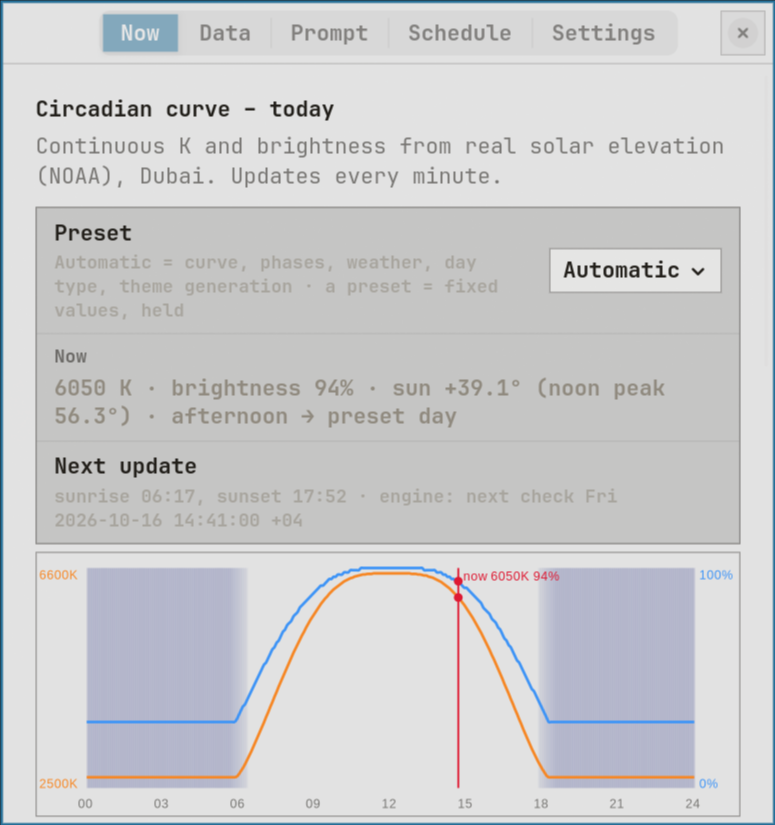
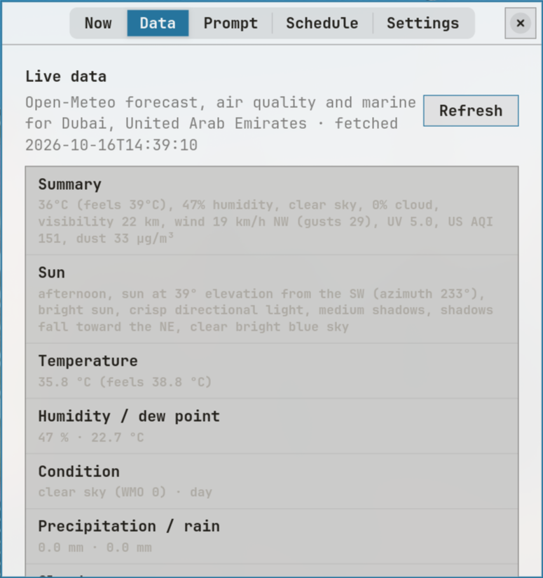
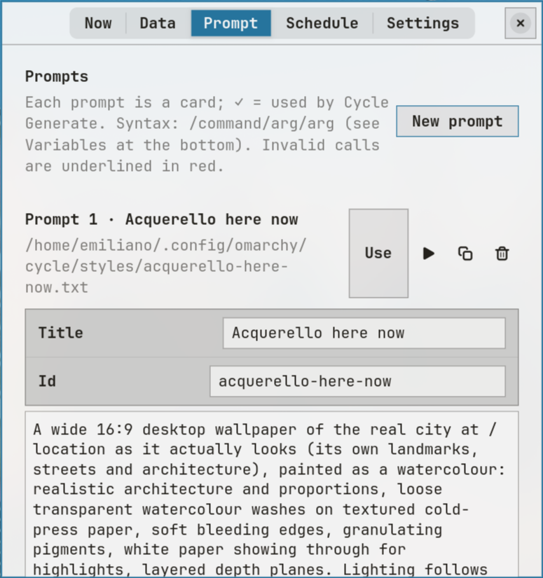
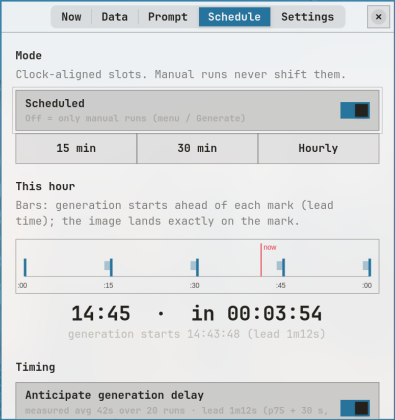
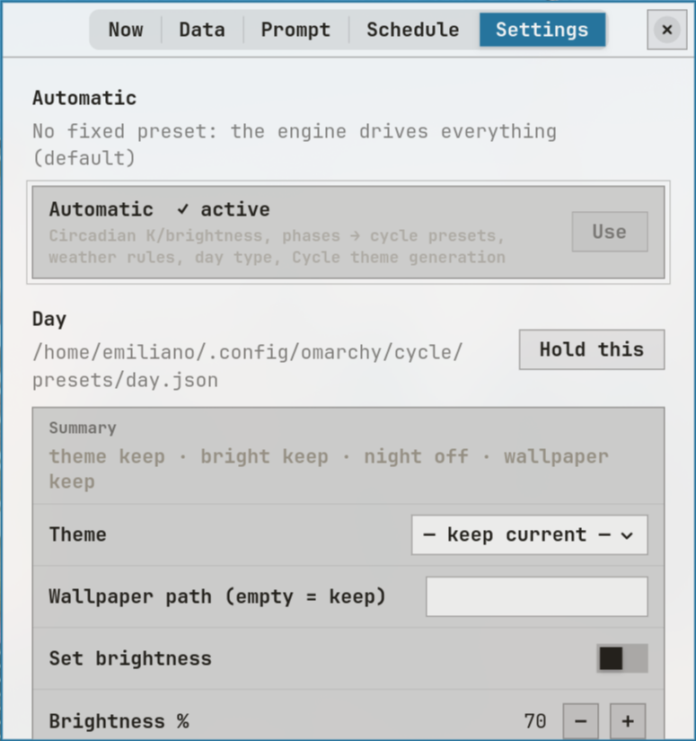

# Cycle

> **Your display, in step with the sun.** A time-of-day brightness, theme and wallpaper engine for Omarchy (Arch Linux + Hyprland).



**Cycle** is a native Rust app (GTK4 / libadwaita) built for **[Omarchy](https://omarchy.org)**. It runs your screen through the day: brightness and colour temperature follow the real sun position, a generated wallpaper and matching colour theme reflect live conditions outside, and when you adjust something yourself, Cycle respects it, and learns from it.

### Why it matters
Most auto-brightness or night-light tools either fight you (they re-apply their value a minute after you change it) or make you edit config files to change their defaults. Cycle keeps your manual change for the rest of the time slot, and if you keep correcting it the same way, it adopts your preference as the new default.

### Key features
- **Sun-based slots:** **morning, afternoon, evening, night**, with boundaries computed daily from sunrise, solar noon, sunset and civil dusk at your location. No fixed clock hours, and it follows the seasons.
- **Manual override kept until the next slot:** change brightness yourself and Cycle holds your value until the slot changes.
- **Every override logged:** time, slot, Cycle's base value and your value, in `~/.local/state/cycle/overrides.json`.
- **Learns your preference:** 3+ overrides in the same direction on different days, and the median becomes that slot's learned brightness (approached at most 5 points per day).
- **Live-data wallpapers + palette theme:** prompts you write are filled with live weather, air quality, sea, sun position and news headlines, sent to an image generator you configure, and applied as the wallpaper of a generated **Cycle** Omarchy theme whose colour palette is extracted from the image.
- **Weather rules:** presets for hot (≥ 40 °C), rain and sandstorm (dust ≥ 150) conditions, from Open-Meteo (no API key).
- **Agent and bar integration:** an icon-only bar widget in the centre of the Omarchy bar, plus a scriptable CLI with JSON output that agents on the machine can read and trigger.
- **Lightweight:** one small binary plus a systemd user timer. No daemon, no sudo.

## Contents
- [Key features](#key-features)
- [Requirements](#requirements)
- [Install from scratch](#install-from-scratch)
- [First-run quickstart](#first-run-quickstart)
- [Usage (CLI)](#usage-cli)
- [Screenshots](#screenshots)
- [Omarchy integration: agents and the bar](#omarchy-integration-agents-and-the-bar)
- [How it works](#how-it-works)
- [Fresh install: what to expect](#fresh-install-what-to-expect)
- [Generator command](#generator-command)
- [Prompts (Prompt tab)](#prompts-prompt-tab)
- [Day phases](#day-phases-no-fixed-clock-hours)
- [Brightness override and learning](#brightness-override-and-learning-srcbrightrs)
- [Config and state files](#where-things-live)
- [Uninstall](#uninstall)
- [Troubleshooting / FAQ](#troubleshooting--faq)
- [License](#license)

## Requirements
- **Omarchy** (Arch Linux + Hyprland). Cycle calls Omarchy's own tools: `omarchy-theme-set`, `omarchy-theme-bg-set`, `omarchy-theme-current`, `omarchy-notification-send`, and `hyprctl hyprsunset` for colour temperature.
- **Rust toolchain** (via `rustup`; the crate uses edition 2024, so a recent stable Rust).
- **GTK4 ≥ 4.12 and libadwaita ≥ 1.7** (system packages: `sudo pacman -S gtk4 libadwaita`).
- **brightnessctl** for reading and setting the backlight (`brightnessctl -m`, `brightnessctl set N%`).
- **systemd user session** (for `cycle-engine.timer`).
- Optional: **NetworkManager** (`nmcli`) or `iwgetid` for Wi-Fi-based location rules.
- Optional: **[Grok CLI](https://github.com/xai-org/grok-cli)** (installed and logged in), or any other command that writes a PNG, for wallpaper generation. See [Generator command](#generator-command).
- Optional: a `~/.local/bin/omarchy-display` helper script. Presets apply dark/light mode, preset brightness, warmth and night shift through it. It is **not** included in this repo; without it, those preset steps are skipped, while slot brightness (brightnessctl) and theme/wallpaper changes still work.

## Install from scratch
```sh
git clone https://github.com/emrgim/Cycle && cd Cycle
./install.sh        # cargo build --release, installs ~/.local/bin/cycle, systemd user units and desktop file (no sudo)
cycle engine on     # turn on the display engine and enable cycle-engine.timer (runs `cycle tick` every minute)
```
Make sure `~/.local/bin` is on your `PATH`.

Install the bar widget (optional):
```sh
cp -r omarchy-plugin/emiliano.cycle ~/.config/omarchy/plugins/
# add {"id": "emiliano.cycle"} to the "center" section of ~/.config/omarchy/shell.json, then restart the shell
```

## First-run quickstart
1. **Open the app:** `cycle app` (or Super+Space → Cycle).
2. **Enable Automatic Cycle** in the **Now** tab (same as `cycle engine on`).
3. **Set your location** in **Settings → Location and Wi-Fi** (the default is Dubai).
4. **Set up the generator** in **Settings → Generation** if you want wallpapers (install and log into the Grok CLI, or replace the command).
5. **Create a prompt** in the **Prompt** tab, e.g. `A wide city skyline at /time, sky /sun, weather /weather`. Check the live preview, then press **Generate** to try it.
6. **Schedule it** on the prompt card / **Schedule** tab: pick an interval (15, 30, 60, 120 or 180 min) and a window (dawn–dusk or always).

## Usage (CLI)
```text
cycle app                         open the window (tabs: Now, Data, Prompt, Schedule, Settings)
cycle tick [--force]              one engine step (what the timer runs every minute)
cycle apply-now                   apply the current slot immediately
cycle resolve | state             show the resolved slot/preset | current display state (JSON)
cycle apply-preset NAME           apply a preset once
cycle hold NAME | hold automatic  pin a preset | return to automatic
cycle engine on|off | engine-is-on
cycle generate [--prompt ID]      live data → prompt → image → Cycle theme → archive
cycle schedules                   last/next run and status of each prompt schedule
cycle prompts [list [--titles]|sync-menu]
cycle open --prompt ID            open the app on a prompt
cycle live | prompt | expand TEXT print live data | the prompt | a resolved text
cycle theme-gen [--force] [--apply] | test-gen
cycle profile | reset-profile [SLOT]
cycle brightness-step --slot S --base N [--at ISO]   (testing)
```

## Screenshots
Each tab of the Cycle app, captured on SuperOmi.

### Now
Circadian curve for today (colour temperature and brightness from the sun's elevation), the current slot and preset, and the next update.


### Data
Live data used by Cycle (Open-Meteo weather, air quality, marine, sun position).


### Prompt
Prompt cards for the generated wallpaper, with the inline composition language.


### Schedule
Clock-aligned generation slots, the next run and timing.


### Settings
Automatic mode and fixed presets (theme, wallpaper, brightness, warmth) that you can hold.


## Omarchy integration: agents and the bar
- The Omarchy bar on SuperOmi has an **agents icon** (the "My Agents" panel with usage and limits for the AI coding agents). Cycle sits next to it as a peer.
- Cycle has its own bar widget, `emiliano.cycle` (an Omarchy quickshell plugin, see `omarchy-plugin/`), placed in the **center of the bar**. It is an icon-only button drawn with the same `BarIconButton` style as the agents icon.
  - **Left click** opens the Cycle app (`cycle app`).
  - **Right click** triggers Cycle right away (`cycle apply-now`): it applies the current slot immediately.
- Because Cycle is a plain CLI (`cycle tick`, `cycle state`, `cycle profile`, `cycle apply-now`, …) with JSON output, agents running on the machine can read its state or trigger it from the shell.
- Cycle also adds entries to the Omarchy launcher menu (Super+Space → Cycle) and installs a desktop file.

### Install the bar widget
```sh
cp -r omarchy-plugin/emiliano.cycle ~/.config/omarchy/plugins/
# then add {"id": "emiliano.cycle"} to the "center" section of ~/.config/omarchy/shell.json and restart the shell
```

## How it works
- `cycle-engine.timer` (systemd user) runs `cycle tick` every minute.
- On each tick, `tick` resolves the current slot from today's sun events and loads that slot's preset (brightness and warmth).
- `bright.rs` then compares the real backlight with the value it last set:
  - if the gap is more than 2 points, it records an override and holds your value for the rest of the slot;
  - otherwise it applies the base value, which may be a learned one.
- State files live in `~/.local/state/cycle/`: `brightness.json` (engine state), `overrides.json` (log) and `profile.json` (learned values).


## Reference

### Where things live
State: `~/.local/state/cycle/` (`brightness.json`, `overrides.json`, `profile.json`, `schedules.json`, `weather.json`, `last.json`, `generate.lock`). Generated images: `~/.local/share/cycle/generated`. Generated theme: `~/.config/omarchy/themes/cycle`.

| What | Path |
|---|---|
| Source (single crate) | `src/` — `main.rs` (CLI), `core.rs` (config, engine, NOAA sun, apply, theme generation), `live.rs` (Open-Meteo, RSS, prompt, `cycle generate`), `theme.rs` (palette from image, Omarchy CSS), `ui.rs` (GTK4/libadwaita window) |
| Binary | `~/.local/bin/cycle` |
| Settings | `~/.config/omarchy/cycle/settings.json` (+ `presets/`, `cycles/`, `styles/*.txt` prompt presets, `styles/active`, `weather-now.json`) |
| Systemd user units | `packaging/` → `~/.config/systemd/user/`: `cycle-engine.timer` (every minute), `cycle-generate-now.service` (manual run); scheduled prompts run as transient units started by `cycle tick` |
| Archive | `~/Pictures/desktop/YYYY-MM-DD/HHMM.png` |
| Window styling | real Omarchy theme: `~/.config/omarchy/themed/cycle.css.tpl` rendered with `~/.local/state/omarchy/current/theme/colors.toml` |
| Launcher menu | `~/.config/omarchy/extensions/omarchy-menu.jsonc` (`cycle.*`), `~/.local/share/applications/cycle.desktop` |
| Floating window rule | `~/.config/hypr/looknfeel.lua` (class `dev.emiliano.Cycle`) |

## Build / install / run
```sh
git clone https://github.com/emrgim/Cycle && cd Cycle
cargo build --release        # needs gtk4 ≥ 4.12 and libadwaita ≥ 1.7 (system), Rust via rustup
./install.sh                 # builds, installs ~/.local/bin/cycle, units and desktop file (no sudo)
cycle app                    # open the window (tabs: Now, Data, Prompt, Schedule, Settings)
cycle generate               # live data → prompt → image → apply Cycle theme → archive
```
Other subcommands: `tick [--force]`, `apply-now`, `resolve`, `state`, `apply-preset NAME`, `hold NAME|automatic`,
`engine on|off`, `engine-is-on`, `theme-gen [--force] [--apply]`, `test-gen`, `live` (print live data), `prompt` (print the prompt without generating).
`generate --prompt ID`, `schedules`, `prompts list|sync-menu`, `open --prompt ID`, `expand TEXT`.


## Fresh install: what to expect
Cycle starts after `./install.sh`, but **generates nothing until you configure it**.

- **Automatic Cycle is off.** Turn it on in the **Now** tab. The engine timer (`cycle-engine.timer`) is only enabled by `install.sh` when the engine is already on; otherwise enable it with `cycle engine on` (or the Now tab toggle).
- **The styles folder is empty.** `~/.config/omarchy/cycle/styles` ships with no prompt files, so there are no prompts and no schedules until you create one in the **Prompt** tab.
- **Location defaults to Dubai** (fixed in settings until you change it).
- **Generation window** defaults to **06:00–18:00** (dawn–dusk style scheduling once a prompt has a schedule).
- **Default RSS feed:** Google News Dubai. **Open-Meteo** needs no API key.
- **Without a working generator command** (see below), generation fails and the **current wallpaper is kept**.
- **Bar widget** (`emiliano.cycle`) is installed manually — see [Install the bar widget](#install-the-bar-widget) above.

Brightness slots, sun-based phases, Open-Meteo data and the override/learning loop still work without image generation.

## Prompts (Prompt tab)
Prompts are text files `~/.config/omarchy/cycle/styles/<id>.txt` (titles in `settings.prompt_titles`, the active one in `styles/active`).
Each prompt is a card in the Prompt tab with a title, id, full editor, slash autocomplete, inline errors (red underline),
a live preview with every variable resolved, Use / Generate / Duplicate / Delete, and a schedule.

### Composition language (`src/lang.rs`, unit-tested: `cargo test --release`)
```text
prompt   := { text | call | legacy }
call     := "/" name { "/" arg }        -- must start the text or follow whitespace or ( [ , ; : " '
name     := [a-z] [a-z0-9_]*
arg      := [A-Za-z0-9_+%-]+            -- "_" or "+" inside a city/query value = space
legacy   := "{{" name "}}"
args     := { keyword }   keyword := "city" value | "query" value | "today" | "tomorrow" | "yesterday"
```
| Command | Args | Value |
|---|---|---|
| `/weather` | city, today/tomorrow/yesterday | live weather (current) or daily forecast for that day |
| `/air` | city, day | AQI, PM2.5, PM10, dust, AOD |
| `/sun` | city, day | phase, elevation, azimuth, shadow direction, sky colour |
| `/dawn` `/sunrise` `/solar_noon` `/sunset` `/dusk` | city, day | civil dawn (−6°), sunrise (−0.833°), transit, sunset, civil dusk (−6°) |
| `/location` | city | name and coordinates (geocoded with the Open-Meteo geocoding API) |
| `/news` | city, query | LED billboard headline (enabled feeds; with args a Google News search) |
| `/breaking` | – | Google News top story, falls back to `/news` |
| `/phase` `/time` `/date` `/now` `/today` `/tomorrow` `/yesterday` | – | day phase / clock / dates |
| `/style` | – | text of the style preset `settings.prompt_style` (default gits-clean) |
| `/image1`… | – | reference image paths from `settings.images` |

Examples: `/weather/city/Genova/tomorrow`, `/sunrise/tomorrow`, `/sun/city/Tokyo`, `/air/city/Genova`, `/news/query/expo_city`.
Default location: Dubai. Network results are cached for the run. Unknown commands/invalid args are flagged in the editor and
left as `/call [!error]` if generated anyway. Rain is only described when live data reports precipitation.
Headlines never repeat: shown ones are recorded in `~/.config/omarchy/cycle/headlines-used.txt` and skipped.
`cycle expand 'text'` prints a resolved text (errors on stderr).

### Schedules
`settings.schedules.<id> = {"enabled": true, "every_min": 60, "window": "dawn-dusk" | "always"}` (editable on the card).
Slots are aligned to the clock, not intervals: `every_min` 15 → :00 :15 :30 :45, 30 → :00 :30, 60 → hourly at :00,
120 → :00 of even hours, 180 → :00 of hours divisible by 3 (other values fall back to hourly). Next run = next aligned mark inside
the window (dawn → civil dusk by default). Manual runs (menu / Generate button) never shift the slots. If a run is still going
when a mark arrives, that mark is skipped (status “skipped HH:MM”). Fired/skipped marks are recorded as `last_slot` in
`~/.local/state/cycle/schedules.json`.
`cycle-engine.timer` runs `cycle tick` every minute; tick starts due prompts as transient units `cycle-gen-HHMMSS`
(`cycle generate --prompt <id>`). A lock file (`~/.local/state/cycle/generate.lock`, pid) prevents overlapping runs.
Each run re-resolves every variable, generates (timeout ≥ 1200 s), applies the Cycle theme and archives to
`~/Pictures/desktop/YYYY-MM-DD/HHMM.png`; a failed or stale run applies/archives nothing and sends a notification.
`cycle schedules` shows last/next run and status. The old hourly cycle-weather/cycle-generate timers are gone.

### Launcher menu
`Cycle Prompts` (in the Super+Space Cycle menu) lists every prompt by title; each opens Generate / Edit
(`cycle generate --prompt <id>`, `cycle open --prompt <id>`). The rows are generated into
`omarchy-menu.jsonc` by `cycle prompts sync-menu` (run automatically when prompts change), because the Omarchy shell only
supports its built-in providers. `cycle prompts list [--titles]`.

The image command is `generator.command` in settings (default `grok -p {prompt_q} --always-approve --output-format json`) with
`generator.timeout` (default and minimum 1200 s). If generation fails or times out, the current wallpaper is kept.


## Generator command
In the Cycle app, open the **Settings** tab and scroll to the bottom. The last section is **Generation**. It has three fields:

| Field | What it is |
|---|---|
| **Prompt template** | Text used when building the image prompt |
| **Generator command** | Shell command Cycle runs to produce the wallpaper PNG |
| **Generator timeout (s)** | Timeout for that command (seconds) |

The same values are stored in `~/.config/omarchy/cycle/settings.json` under `generator.command`, `generator.timeout`, and the prompt template fields.

### How Cycle runs the command
Cycle runs the generator command itself with `bash -c`. Before running it, Cycle substitutes placeholders in the command string:

| Placeholder | Meaning |
|---|---|
| `{prompt_q}` | The full prompt, **shell-quoted** (safe to pass as one argument) |
| `{prompt}` | The full prompt, **raw** (unquoted) |
| `{out}` | Absolute path of the target PNG file Cycle expects |

The command **must write a PNG** at `{out}`. Cycle then uses that file as the Cycle theme wallpaper (and archives a copy under `~/Pictures/desktop/`).

### Default (Grok CLI)
The default `generator.command` is pre-filled as:

```sh
grok -p {prompt_q} --always-approve --output-format json
```

That is the [Grok CLI](https://github.com/xai-org/grok-cli) only as a **default string**. Cycle does **not** install or log you into Grok. On a fresh machine you must install the Grok CLI separately and complete its login before generation works. Any other command that saves a PNG to `{out}` is a valid replacement (another image CLI, a local script, a curl wrapper, etc.).

### Timeout and failure
The effective timeout is at least **1200 seconds**: the code uses `max(timeout, 1200)`. If generation fails or times out, Cycle **keeps the current wallpaper**, applies nothing from that run, and shows a **desktop notification**.

## Day phases (no fixed clock hours)
Boundaries are recomputed every day from the NOAA sun model for the configured location (`core::sun_events`):

| Phase | Starts at | Variable |
|---|---|---|
| morning | sunrise (sun at −0.833°) | `sunrise` |
| afternoon | solar noon (meridian transit) | `solar_noon` |
| evening | sunset (−0.833°) | `sunset` |
| night | civil dusk, end of civil twilight (−6°) | `civil_dusk` |

Also available but not used as boundaries: `civil_dawn`, `nautical_dusk` (−12°), `astronomical_dusk` (−18°).
`settings.json` → `times` = `{"morning":"sunrise","afternoon":"solar_noon","evening":"sunset","night":"civil_dusk"}`.

Dubai, 15 Oct 2026 (GST): civil dawn 05:54 · **sunrise 06:17** · **solar noon 12:04** · **sunset 17:53** · **civil dusk 18:16** · nautical dusk 18:43 · astronomical dusk 19:09.

## Brightness override and learning (`src/bright.rs`)
- **Override**: every tick Cycle compares the screen brightness with the value it last set. A difference of more than 2 points is a manual change: Cycle keeps it and does not touch brightness again until the next slot (day phase: morning / afternoon / evening / night). Further manual changes in the same slot update the override.
- **Log**: every override is appended to `~/.local/state/cycle/overrides.json` (`at`, `slot`, `base`, `user`). Engine state is in `~/.local/state/cycle/brightness.json`.
- **Learning**: if a slot has 3 or more overrides in the same direction on different days (last override of each day, last 7 days with overrides), the median of those user values becomes the slot's learned base in `~/.local/state/cycle/profile.json`. Cycle moves the effective base towards it by at most 5 points per day (`current` → `target`).
- Commands: `cycle profile`, `cycle reset-profile [SLOT]` (the override log is kept), `cycle brightness-step --slot S --base N [--at YYYY-MM-DDTHH:MM:SS]` (one brightness step, for tests). `CYCLE_STATE_DIR` and `CYCLE_BRIGHTNESS_FILE` redirect state and brightness to test files.

## Uninstall
```sh
systemctl --user disable --now cycle-engine.timer
rm -f ~/.config/systemd/user/cycle-engine.{service,timer} ~/.config/systemd/user/cycle-generate-now.service
systemctl --user daemon-reload
rm -f ~/.local/bin/cycle ~/.local/share/applications/cycle.desktop
rm -rf ~/.config/omarchy/plugins/emiliano.cycle    # and remove its entry from ~/.config/omarchy/shell.json
# optional, removes all settings, prompts, logs and generated images:
rm -rf ~/.config/omarchy/cycle ~/.local/state/cycle ~/.local/share/cycle ~/.config/omarchy/themes/cycle
```
Also remove the `cycle.*` entries from `~/.config/omarchy/extensions/omarchy-menu.jsonc` if present. Switch to another Omarchy theme first if the Cycle theme is active.

## Troubleshooting / FAQ
- **Nothing changes during the day.** Automatic Cycle is off on a fresh install: run `cycle engine on` and check `systemctl --user status cycle-engine.timer`. Run `cycle tick --force` to see what it does.
- **Brightness doesn't change.** Check `brightnessctl -m` works for your user (backlight permissions). If you changed brightness by hand, Cycle is holding your override until the next slot. That's by design.
- **Generation fails / wallpaper never changes.** Run `cycle test-gen` or `cycle generate` in a terminal. Check that the generator command works on its own and writes a PNG to `{out}`. On failure the current wallpaper is kept and a notification is shown.
- **No prompts or schedules.** The styles folder starts empty; create a prompt in the Prompt tab.
- **Wrong sunrise/sunset times.** Set your location in Settings; slots are computed for the configured coordinates.
- **Learning went the wrong way.** `cycle reset-profile [SLOT]` clears learned values (the override log is kept).
- **Does it need an API key?** Not for weather data (Open-Meteo). Image generation depends on the generator you configure.
- **Does it need root?** No. Everything installs in your home directory.

## License
License: not yet specified.
